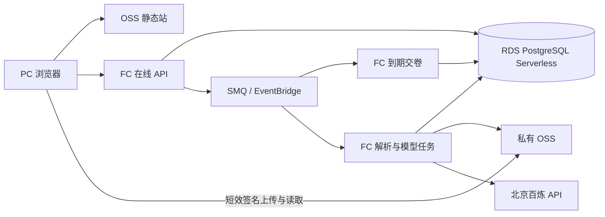

# 背题宝生产技术架构

2026-11-07 · v1.0 · 实施选型已定，发布须通过容量、样卷和合规验收

## 1. 系统概览（System Overview）

依据 [产品需求](prd.md) 的 FR-001～008 和 NFR-001～004。面向中国高校 PC 网页。按期中、期末日历运行，淡季近零访问。工作区当前无 Git 仓库，PC 原型采用本地状态，Sites Worker 提供静态资源与页面回退。生产沿用原型交互，从本地 PRD 定义接口与规则。技术组合按季节性负载、事务和证据要求确定，外部示例只作为具体组件的实现参考。

**定案**采用阿里云华北 2（北京），React 静态前端、函数计算 FC 3.0、RDS PostgreSQL Serverless 高可用系列、私有 OSS、轻量消息队列 SMQ（原 MNS）和百炼按量 API。单代码库模块化单体，在线 API、试卷解析与模型任务分别设置部署入口、实例上限和超时。高可用数据库用于降低考试窗口单节点故障风险。首期单地域，恢复目标见第 7 节。

## 2. 架构模式与组件（Architecture Pattern & Components）

| 组件 | 实施 |
|---|---|
| Web | 复用 React/Vite 页面与导航，生产代码采用 TypeScript。题目和公式用安全的结构化渲染，草稿用 IndexedDB 暂存未确认的修订，服务端为最终来源。静态资产采用内容哈希，入口 HTML 短缓存。私有响应使用 no-store。 |
| 在线 API | Node.js 24 LTS 自定义运行时、Fastify、pg、SQL 迁移、JSON Schema。FC 使用满足官方安全基线的公共层，固定运行时及依赖版本。科目、核对、组题、考试、错题和预测元数据在同一数据库。 |
| 文件与解析 | OSS 分离静态站、隔离上传和私有材料权限。解析入口用独立 Linux 容器运行受限 PDF 工具（Poppler），提取文本块与坐标，按页渲染扫描件及复杂版式。只从可信 OSS 对象键读取。安全扫描和解析设 CPU、内存、页数、像素与超时上限。 |
| 异步任务 | SMQ 通过 EventBridge 触发 FC。到期交卷、上传解析、答题反馈/解答、预测分队列与并发。队列载荷仅任务 ID。按需扩展 CPU，模型调用按 Token 付费。 |
| 运维 | 基础设施用 Terraform 与受版本管理的部署脚本。线上和试点环境隔离，使用 RAM 角色、密钥管理和短期凭证。RDS 只开 VPC 内网，模型调用走 FC 默认出网，经指定北京工作空间域名；上线验证出网策略和数据处理条款。 |

[FC 网络](https://help.aliyun.com/zh/functioncompute/how-do-functions-in-a-vpc-access-the-internet-1) · [Node.js 安全基线](https://help.aliyun.com/zh/functioncompute/security-notice-function-compute-nodejs-runtime-vulnerability) · [SMQ 触发器](https://help.aliyun.com/zh/functioncompute/mns-queue-triggers) · [百炼地域](https://help.aliyun.com/zh/model-studio/regions)

## 3. 数据模型（Data Model）

| 聚合 | 关键数据及一致性 |
|---|---|
| 用户与科目 | tenant_id 即个人账号边界。科目以 tenant_id、名称、规范化教师、学期做唯一键。所有业务表复合外键带 tenant_id，API 查询显式校验归属并以 RLS 作为补充。RLS 租户上下文在事务中设置，业务角色无绕过权限，运维和任务使用分离角色。 |
| 试卷及来源 | paper、paper_version、page_version；存上传哈希、对象版本、用户页序、印刷页码、章/题号、卷首说明、时长、已知分值。题目来源关联一个或多个归一化区域及页版本。确认前记录断页、疑似漏题、图表、选项及共用材料。 |
| 题目及答案 | question_id 为逻辑题，question_version 是内容版本，answer_version 独立，记录来源、核验人及证据。相同题候选按同科规范化哈希查找，用户确认后共享题版本。保留原始关系和拆分记录，撤销合并后按原出处重算，来源归属不明时待复核。 |
| 知识点与预测 | 同科别名词表和 PostgreSQL 关系表保存直接考点、共现与有证据的先修关系。预测保存输入版本摘要、蓝图、候选题、来源 ID、推演理由。科目行串行更新唯一当前预测指针。材料变化标为待更新，旧卷继续供历史会话访问。 |
| 练习与进展 | 会话锁定卷面、题目与答案版本及截止时间。作答与自评独立持久化。覆盖以 tenant_id、question_version 为唯一键，跨卷按确认来源关联；预测卷与原卷分开统计。答案变化保留覆盖并使相关反馈待复核，题干实质变化产生新覆盖版本。错题按逻辑题聚合，保留尝试和来源。 |
| 任务与计费 | job、outbox、model_usage 持久化状态、租户、输入版本摘要、提示词/模型/协议版本、租约、尝试、上限预留和实际用量。来源与历史版本可回查。 |

## 4. 接口与一致性（API Specifications）

REST /api/v1，HTTP JSON，OpenAPI 冻结后供前后端联调。首发邀请制账号，使用一次性邀请码和 Argon2id 密码凭据，登录限流；会话 cookie 为 Secure、HttpOnly、SameSite，写请求验证 Origin 与 CSRF。凭据和账号找回通过验证过的邮件通道实现，供应商费用入账。跨子域仅允许确定的前端 Origin。

| 接口 | 合约 |
|---|---|
| POST /courses，GET /progress | 创建或返回已有科目，按当前原卷覆盖聚合总数、完成及剩余。继续背题优先恢复原卷草稿。 |
| POST /uploads，POST /uploads/{id}/complete | 签发绑定对象键及长度限制的上传凭证。完成后核验对象大小与版本后登记隔离区解析任务，返回 202 与任务 ID。异步检查内容和页数，通过后转入私有材料。 |
| GET /jobs/{id}，POST /jobs/{id}/retry | 前台可见时退避轮询，终态停止。手动重试沿用任务逻辑 ID 和预算约束。 |
| PATCH /papers/{id}/pages，PATCH /questions/{id} | 页序、旋转、补页、确认和纠错按预期版本更新；旧任务只归档，当前指针通过 CAS 发布。只有已确认题进入专项、聚合与预测，原卷开练前校验整卷及漏页状态。 |
| POST /practice/preview，POST /attempts | 服务端按科目 → 题型 → 原卷筛选，校验状态与归属，去重后锁版本。预测卷复用会话。 |
| PATCH /attempts/{id}/draft，POST /attempts/{id}/submit | 草稿带修订号，冲突返回 409 并保留本地输入；交卷可携最终草稿，服务端原子提交。提交重放返回同一结果 ID。 |
| POST /attempts/{id}/recall，GET /attempts/{id}/result | 自评与确定性评分分开记录；结算前会话只返回卷面，不下发答案字段、泄题原页或推演证据。闭卷 UI 隐藏这些入口；用户此前合法保存的材料无法撤回。 |
| POST /courses/{id}/prediction，GET /courses/{id}/prediction | 首次按需生成，输入摘要相同返回当前任务或产物；材料有变化由用户触发更新。读取前验证全部证据属于同科。 |
| GET /mistakes，POST /mistakes/{id}/actions | 展示收录原因、历史和状态；手动收藏单独记账，重练复用会话。 |

**交卷事务**锁会话行，以数据库时间判截止；锁内校验修订号并提交最终答卷、确定性结果、覆盖、错题与反馈任务 outbox。截止后只接受此前服务端已确认的草稿。会话创建时事务登记延时交卷，定时、访问补偿和人工点击共用提交逻辑，受唯一结果约束。首期自定义限时最长 6 小时，SMQ 延时消息覆盖此范围。主观反馈异步补充，写入时检查当前版本和最新尝试，避免旧反馈覆盖新状态。已核验客观题规则判分，无法确定等价时待复核。[SMQ 延时](https://help.aliyun.com/zh/mns/developer-reference/delayed-messages)

**任务交付**业务写和 outbox 同事务，提交后尝试立即投递，投递成功才标记。考期每分钟补偿，淡季每天一轮，主动重试时也可补投。消费者按唯一任务键领取带过期时间与 fencing token 的租约，结果与任务终态同事务提交后才确认消费。失败分类重试，超限入死信并保留可重试任务，恢复过期租约和逾期会话。外部模型超时可能已计费，调用前持久化预算预留与尝试号，未知结果保留预留，优先按请求 ID 对账，有限重试；应用结果幂等与供应商计费独立。数据库事务在等待模型响应前关闭。

## 5. 模型能力与降本路线（Technology Stack）

| 环节 | 路由 | 输出与门槛 |
|---|---|---|
| 试卷识别 | 可信文本层先解析，照片、扫描页或版式校验失败页交 qwen3.5-flash-2026-02-23。疑难图表、公式与跨页冲突只把相关裁片和相邻块交 qwen3-vl-plus。 | 按题号层级输出题干、选项、LaTeX、共用材料、来源页和区域。程序检查坐标边界、选项完整度、题号断点和块归属，疑似漏识或公式歧义逐题待核对。 |
| 解题与标注 | 教师答案优先，先校验题号和版本绑定。纯文本常规题用 qwen-flash-2025-07-28。复杂文本用 qwen-plus-2025-12-01，视觉依赖题用 VL Plus。 | 客观题答案与理由，计算题条件、关键步骤、单位和结果，主观题参考要点与可接受表述，直接考点及有据关系。输出支持无法确定和缺失证据。模型生成答案默认待核验，模型间一致仅用于风险分流。 |
| 主观反馈 | 用 qwen-flash 对已提交文本及评分要点按需做一次反馈。图片作答或关键证据不足可由用户自评或待复核，图片反馈仅向通过相应评测的分层开放。 | 输出命中要点、缺漏和对应作答片段。无可信标准时显示参考反馈或待复核。 |
| 预测卷 | PostgreSQL 按同科、确认状态、题型和考点统计，确定性抽取少量带来源的证据和题型蓝图。qwen-plus 非思考模式分组出题，发布前做可解性和证据校验。 | 每题有参考答案、评分要点、有效来源和推演理由。单卷标依据有限，未覆盖内容标未知。拒绝近重复、矛盾、缺失图表及越界引用。显示材料观察与模型推演。 |

全部模型通过同一适配层固定快照、区域和提示词版本。默认非思考模式，结构化 JSON 经服务端 Schema 与业务约束校验。按单卷原文档或局部证据处理，生产路径禁用联网、外部工具和任意 URL。模型风险触发条件使用题型、缺项、解析与规则冲突，以及分层评测结果。每工作项至多一次质量升级，失败交人工核对或显示证据不足。对上传内嵌指令做不可信数据隔离。程序处理精确匹配、客观规则评分、组题、统计与重复查找，打开旧题、反复背题、读历史和交卷本身均可零模型调用。缓存键为租户、任务、规范化输入及版本摘要、模型快照和提示词版本。编辑只重算受影响部分，预测每科只维护一套当前卷。模型和图片均设置单次输入输出硬上限，首期单请求输入至多 32k Token。保留实际用量，定期按质量与成本更新路由。

[视觉 Flash](https://help.aliyun.com/zh/model-studio/qwen3-vl-flash) · [视觉 Plus](https://help.aliyun.com/zh/model-studio/qwen3-vl-plus) · [文本 Flash](https://help.aliyun.com/zh/model-studio/qwen-flash) · [文本 Plus](https://help.aliyun.com/en/model-studio/qwen-plus)

## 6. 资源、预算与取舍（Deployment & Trade-offs）

- **淡季** FC 最小实例数 0，数据库启用自动启停，空闲连接须在秒级关闭，探活走独立静态接口。异常上传保留重试通道，每日补偿会短暂唤醒数据库，需记入成本。数据库唤醒时返回可重试的 503 与等待状态，避免放大重连。淡季首次访问可能等数分钟。[FC 计费](https://help.aliyun.com/zh/functioncompute/billing-overview-of-fc) · [RDS 自动启停](https://help.aliyun.com/zh/rds/apsaradb-rds-for-postgresql/configure-the-automatic-start-and-stop-feature-for-a-serverless-apsaradb-rds-for-postgresql-instance)
- **考试窗口** 按学校日历设开关，开考周前至少 48 小时关闭暂停并完成压测。RDS 起配 0.5～8 RCU，考期初始下限 2 RCU、上限 8 RCU，按压测调整。API 按冷启动结果可在高峰时段保留 1 个实例。数据库连接预算分别分配给在线、交卷、AI 和运维，按 FC 实例上限乘每实例连接上限校验。在线入口与交卷保留独立实例及 DB 配额。批量模型请求受 RPM、TPM、工作项并发和预算四重限制，达到阈值先延迟预测，再延迟新增导卷，既有练习和交卷继续服务。考季结束排空任务，再恢复淡季策略。
- **考期发布容量** 10,000 活跃用户与 100 套非缓存命中新卷并行处理同时验证。沿用草稿每 20 秒合并保存的压测假设，所有用户均作答时约 500 次草稿写入/秒。以 10,000 人在 10 秒内集中交卷作为压力场景，约 1,000 次提交/秒。这些是压测输入，业务流量比例和目标账号资源按实测校准。模型 RPM、TPM、工作项并发与费用预算以实际多页标准卷回放反算，在线和交卷资源与模型队列隔离。试点容量与本机回归不能替代发布容量验收。
- **容量基线** 首轮试点假设 1,000 同时在线、每 20 秒一次草稿合并写入，约 50 次写/秒；另测 1,000 人在 10 秒内集中交卷，约 100 次提交/秒，与导卷并行压测。若 10 分钟到达 300 套卷、每套 8 页、60% 走视觉且一页一请求，则需 144 RPM，按每页共 2,000 Token 为 288k TPM；保留 30% 配额余量后需约 206 RPM、412k TPM。用控制台实际快照配额反算准入量。队列等待预测超过目标时先限制新上传，禁止用扩 FC 代替模型提额。文本与升级路由同样独立反算。
- **云成本示例** 北京高可用双节点、最低计费容量 20 GB、30 天存储约 48.96 元。考期连续 30 天、假设平均 2 RCU，则数据库计算约 959.04 元，另加存储；淡季暂停期间计算为零，若每日巡检后单次按 0.5 RCU 计费 15 分钟，则约多 2.50 元/月。实际账单另加 FC、OSS 容量与下行、队列/事件流、日志、备份、DNS/域名和邮件等。采购前以控制台和试点账单验证地域、可用区、备份规格及最低消费。[RDS 规格](https://help.aliyun.com/zh/rds/apsaradb-rds-for-postgresql/create-a-serverless-apsaradb-rds-for-postgresql-instance) · [RDS 计费](https://help.aliyun.com/zh/rds/apsaradb-rds-for-postgresql/pricing-of-serverless-apsaradb-rds-for-sql-server-instances)
- **取舍（Rationale & Alternatives）** 常驻 API 与 GPU 会把淡季成本变成固定支出。数据库选 PostgreSQL，是因为交卷、覆盖、错题与版本指针需要事务和约束。全文或语义召回达到明确瓶颈时再评估扩展（Future Considerations）。当前证据范围是个人同科已确认材料，关系表与可追溯抽样足以支持首版。单地域降低运维与同步成本，接受地域级故障需备份恢复。

### 模型成本示例

假设每考季新增 10,000 套卷、每卷 8 页和 20 题，人民币，采用北京文档价和下表实付量假设，输出含供应商计费 Token。实际覆盖、重试和高难学科占比须按样本测量。

| 路由 | 请求量 | 每请求输入 / 输出 Token | 每百万输入 / 输出价格 | 合计 |
|---|---:|---:|---:|---:|
| VL Flash 识别 | 48,000 | 1,500 / 500 | ¥0.15 / ¥1.50 | ¥46.80 |
| 文本 Flash 解答 | 200,000 | 1,000 / 400 | ¥0.15 / ¥1.50 | ¥150.00 |
| 疑难补读与解题，按 VL Plus 估算 | 20,000 | 2,000 / 800 | ¥1.00 / ¥10.00 | ¥200.00 |
| 文本 Plus 预测，按每套预测的总 Token | 5,000 套 | 8,000 / 4,000 | ¥0.80 / ¥2.00 | ¥72.00 |
| 合计 | | | | **¥468.80** |

约 ¥0.047/新增原卷，模型分项可用单价乘实际 Token 复算。若升级量翻倍，增加 ¥200。另计反馈、生成后校验的模型调用（若使用）、失败重试和低质量材料；例如每 10,000 次 Flash 文本反馈、每次 1,200/250 Token，约增 ¥5.55。上述价格和规格以第 5 节官方文档与实际账单为准。预算按预估上界预占后对账，设置每用户、每卷、全站日限额。消耗到 70% 告警，85% 暂停新预测，100% 暂停新模型任务，已接受工作量用已预留额度完成。已核验练习正常运行。试点默认每人每天 5 套卷、最多 1 个解析作业和 1 个预测作业并发，额度经实测调整。

## 7. 技术约束与验收（NFR Mapping）

| 约束 | 目标与验证 |
|---|---|
| 隔离与材料使用 NFR-001 | 支持 PDF、JPEG、PNG，单卷最多 30 页 / 50 MB；单图上限 25 MP；拒绝加密和异常文件。上传时确认使用权限，支持遮盖个人字段，默认在发送模型前应用脱敏。签名读取默认 60 秒，有权用户才签发，泄题资产单独授权。验证跨账号 URL、ID、队列任务及历史版本读取均受保护。 |
| 性能与可靠性（Performance & Reliability）NFR-002 | 考期 API P95 ≤ 500 ms、交卷 P95 ≤ 1 s、有效提交成功率 ≥ 99.9%，以 30 分钟目标负载加交卷尖峰验证。对重放、提交与定时竞争、版本更新、进程崩溃、队列重复和供应商超时注入故障。 |
| PC 操作 NFR-003 | 1280×800、1440×900 两个视口，键盘操作选科、选卷、作答、跳转和提交。焦点可见且状态用文字表达，检查长卷滚动、共用材料和答题卡。 |
| 追溯 NFR-004 | 所有产物关联输入版本、原页位置、模型快照及人工修改记录。并发修改后跑旧任务回放，验证零旧写覆盖；历史尝试可重放卷面。 |
| 考期处理体验 | 已接受且在准入容量内的 8 页标准卷，首批识别待核对 P95 ≤ 120 秒；预测 P95 ≤ 180 秒，包含队列等待。以真实 Token、限流、排队和人工核对耗时分别计量。 |
| 可用性、备份和保留（Availability） | 初始策略为原卷及历史默认保留至用户删除或账号连续 24 个月未使用，经到期提示后清理。未完成上传 24 小时、可重建缓存 30 天、无内容操作日志 30 天。在线删除请求立即撤销应用访问，已有签名在短效窗口内失效。对象版本与派生内容 7 天内清理，备份到期滚动清除，恢复时重放删除记录。目标备份 RPO ≤ 15 分钟、RTO ≤ 4 小时，通过 RDS 时间点恢复和 OSS 对象版本演练验证，保留 14 天。该目标适用于已测试的同地域可恢复故障。 |
| 生产发布合规 | 中国内地域名备案、上传与模型数据处理条款、材料授权、删除机制、AI 生成内容标识，以及服务主体适用的备案或登记要求由发布负责人上线前核定。日志仅记录元数据。模型推理区域、数据留存与训练用途以合同和服务设置验证。 |

[OSS 静态托管及备案](https://help.aliyun.com/zh/oss/user-guide/static-website-hosting/) · [生成式人工智能服务管理暂行办法](https://wap.miit.gov.cn/api-gateway/jpaas-web-server/front/document/file-download?fileName=0a6b306b8cab49e99ebd5e6dfef37637.pdf&fileUrl=%2Fcms_files%2F1226211233%2Fattach%2F20238%2F0a6b306b8cab49e99ebd5e6dfef37637.pdf) · [生成合成内容标识办法](https://www.nrta.gov.cn/art/2025/3/14/art_113_70340.html)

### 模型发布门槛

获准使用的真实卷按学科、题型、印刷/拍照质量、公式图表和跨页情况分层，开发集与盲测集按原卷隔离。同学科同题型的放行层初始至少 100 题，预测至少 30 套证据集并进行人工复核。样本不足或分层不达标时保持原卷、人工校对与自评可用，相关模型功能不自动放行。

| 项 | 首轮目标与判定 |
|---|---|
| 识别 | 清晰印刷卷题目边界召回 ≥ 98%，选项完整率 ≥ 99%；复杂层关键公式语义准确率 > 95%，来源页及区域能定位率 ≥ 98%。图表节点、方向、权重及左右子边分别要求 > 95%。疑难层与清晰层分别报告。 |
| 解答 | 客观题模型参考答案准确率、计算题关键步骤正确率及主观题评分点召回均要求 > 95%，同时报错加要点率和待复核率。确定性判分仅使用已核验答案。 |
| 预测 | 程序校验证据引用合法率 100%，人工判断引用确实支持推演的比例、可解性与答案正确率分别要求 > 95%。用冻结的考前卷盲测真实命中，材料授权与样本量达标后再对外报告。 |

门槛是初始验收目标，报告原始分母、置信区间、未通过层、人工校对耗时和单卷实付费用。候选路由以达标后的单位成本与延迟定生产配置。对未通过的题型先抽样校对或调整路由，供应商快照升级必须回归。

## 8. 实施顺序与维护（Delivery & Maintainability）

1. 冻结 OpenAPI、租户和版本数据契约。创建北京测试环境，验证数据库休眠/唤醒、网络、配额、实际模型价格以及备份能力。用授权试卷跑模型样本基线。
2. 实现科目、私有上传、逐题核对及任务状态。接入已有 PC 交互，上传到开练做端到端测试。
3. 实现确定性交卷、跨卷自评、错题和覆盖，再接异步解答与知识点。并行验证限时、幂等、纠错与版本回放。
4. 实现预测蓝图、证据与当前版本指针。用 PRD TC-001～009、分层评测、集中交卷压测和恢复演练作为考季上线验收。应用用 FC 版本及别名逐步切流，数据库迁移遵循先扩展后清理，快照/提示词可独立回退。上线前按实际峰值及实付 Token 修订容量与预算。

## 参考

[PRD](prd.md) · [架构门检](gate-check.md) · [技术拆解与模型接入](implementation-plan.md)
