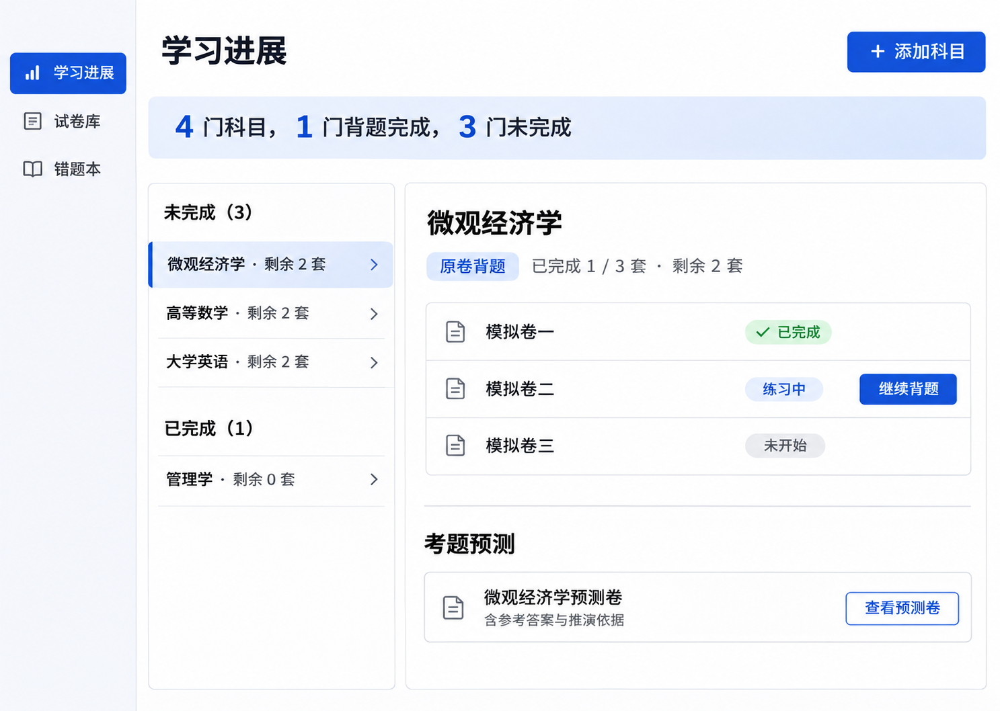
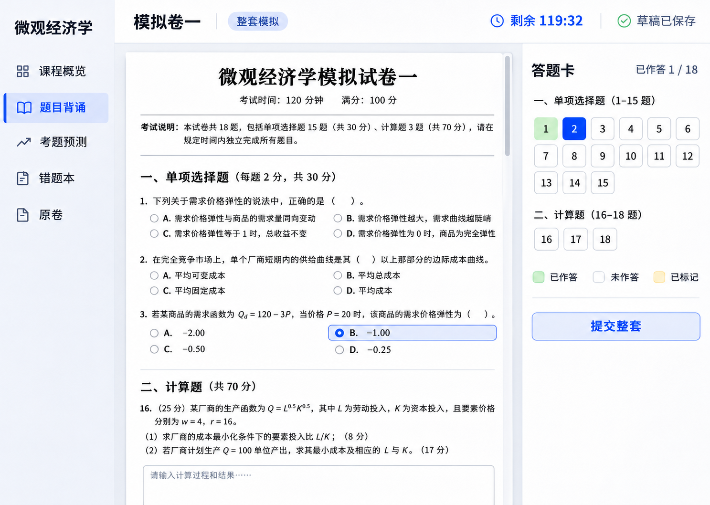
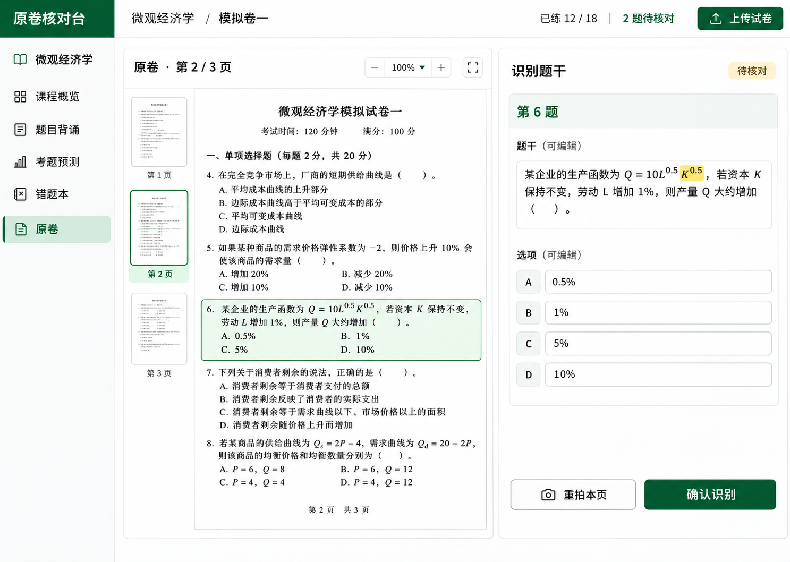

# 背题宝 · 大学纸笔考试复习 · PC 产品需求

版本 1.7 · 2026-11-08 · 历史需求与验收用例

后续已确认的流程和口径见 [当前产品规则](product-rules.md)。涉及账号、上传归档、题干修订、评分、错题日期、预测和考试时间时，先核对 [决策与实现对照](../handoff/decisions-and-coverage.md)，再用本稿的历史用例追溯。

## Executive Summary · 产品摘要

面向中国高校大学生，把教师给定的纸质试卷变成可核对、可背诵、可闭卷模拟的复习材料。学生从「学习进展」进入，添加科目并上传试卷。系统按原卷页码归档，识别题目、解答并关联知识点。学生可完成整套原卷、跨卷背同类题，或练习每科一套预测卷。作答与自评回写进展和错题本。

本稿记录 1.7 版本的交互与统计方案。PC 原型提供布局与导航参考。连接版实现、本机验收与预发运行情况分别记录。[项目交接](../handoff/README.md)

## Project Overview · 使用范围与信息架构

- 学员端和账号管理后台均只支持笔记本电脑浏览器。学员端主导航为「学习进展」「题目背诵」「考题预测」「错题本」「试卷库」。
- 科目按用户、科目名称、教师、学期区分。同名科目可分别管理，跨卷组题与预测以所选科目记录为边界。
- 产品范围覆盖中国高校所有实际采用纸笔考试的本科及研究生课程，包括公共课、基础课和专业课。课程纳入依据为教学大纲、考核安排或实际试卷。按实际卷面的题型、语言与作答形式适配。通用题型之外保留原卷和自定义题型，可用文字、公式、图片作答或进行默背自评。覆盖与解答准确性按学科及题型验收。
- 两条主线同等重要。整套答题和按题型背诵属于「题目背诵」。「考题预测」在同科有可用材料时提供一套当前预测卷。

| 界面 | 主操作 | 关键状态 |
|---|---|---|
| UI-001 学习进展 | 添加科目、筛选完成状态、继续背题、查看预测卷 | 空列表、待上传、待整理、未开始、进行中、已完成 |
| UI-002 试卷库与核对 | 上传文件、确认页序、并排核对原卷与题干、修正识别 | 上传中、处理中、部分可练、待核对、失败可重试 |
| UI-003 背题配置 | 整套选科目与试卷。专项依次选科目、题型、试卷 | 缺少科目、无匹配题、可开练、有草稿 |
| UI-004 整套作答 | 连续卷面作答、答题卡跳题、保存退出、整套提交、查看卷后分析 | 草稿、未答题提醒、提交中、已提交 |
| UI-005 专项与反馈 | 主动回忆、核对要点、自评、查看原卷出处 | 未揭晓、已核对、待巩固、答案待核验 |
| UI-006 预测卷 | 选择科目、生成或查看当前预测卷、整套练习、查看知识网和预测逻辑 | 材料不足、生成中、可练、待更新、生成失败 |
| UI-007 错题本 | 按科目、题型、首次收录日及状态筛选、定位来源、闭卷重练 | 待重练、待复核、已重练、空列表 |

## Functional Requirements · 功能要求

### FR-001 · MUST · 添加科目与进展总览

添加科目须填名称和学期，教师可选。同一用户的同名、同教师、同学期记录提示复用。总览显示「科目总数」「背题完成」「未完成」，未完成包含待上传科目。按原卷显示每科已完成套数、总套数、剩余套数和下一步。无卷时显示「待上传」。继续背题优先恢复未完成原卷草稿，其次进入该科可练的未完成卷选择。

### FR-002 · MUST · 上传归档与原卷校对

首次登录时展示上传引导。有科目时进入试卷库，无科目时先创建一门。试卷库提供把纸质试卷扫描成 PDF 的步骤。只接收 PDF，上传时填写学校全称并选择科目。一次可选最多 30 份 PDF，各自独立归档和识别。批量时用文件名作为试卷名称，每套最多 30 页。部分上传失败时保留失败项，支持单独重试。上传并授权模型处理后，模型从页眉或页脚读取印刷页码。页码齐全、连续且无重号时自动更新卷面顺序。漏读、重号或缺号时保留当前顺序并显示提示。已手动确认的顺序优先，保留原文件位置用于回查。保留原文件、用户确认页序与印刷页码，分开记录两种页码。印刷页码或题号出现断点时展示具体异常。识别须保留题号层级、图表、公式、选项、共用材料和跨页引用。识别结果页左侧显示原图，右侧显示已识别题目与原页位置。

上传时先校验文件并按 SHA-256 查找历史版本。跨账号复用按已核验学校、标准科目和有效共享授权限定查询范围。整文件未命中时以第一页的整页图像指纹查候选，再核对页数与全卷逐页指纹。原卷答案、知识点及预测卷分别校验输入版本，同版本并发上传合并处理。判定和验收用例见 [同校同科试卷复用](product-rules.md#同校同科试卷复用)。

授权模型处理的 PDF 由模型识别并自查题号、选项、数字及公式。系统自动去重并发布识别成功的题目。用户可以在练习中保存自己的题干修正，查看答案后也可以保存自己的答案和解析。题干修正独立保存，原模型解析标明所对应的题干版本。

所有页识别成功且卷内有可用题目时，可直接整套开练。单页识别失败可重试，也可先按题型练习已识别的题目。开始练习时系统可自动排队生成知识点和参考答案。证据不足时说明缺失内容。原始识别及模型和提示词版本可追溯。

### FR-003 · MUST · 模型解答、知识点与纠错

开始练习时按整套或所选题型为已确认题干排队生成缺失的答案与解析。已存在且输入版本一致的结果直接复用。答案未就绪时可继续作答，交卷保留结果并显示解析生成状态，完成后补齐。无法安全匹配或缺少图表、选项等条件时，显示缺失信息并交由用户核对。客观题给出选项或结果，计算题提供条件、步骤、单位与结果，主观题提供参考作答、评分要点并容纳合理的不同表述。答案来源区分「教师提供」「已核验」「模型生成 · 待核验」，仅引用实际提供的材料。客观题仅使用已核验答案做确定性判分，主观题按要点给反馈，证据不足时显示「待复核」。

每题标注直接考查的知识点、可证实的前置知识及同题组合。共现和先修分别存储。点击知识点可查看来源题、前置点与同类题，并返回原作答位置。学生可报错或修正。修改题干、答案或材料产生新版本，受影响解析、聚合和预测需更新或标记待复核。保留历史作答所用版本。

### FR-004 · MUST · 整套答题与统一提交

选择科目和一套原卷。连续卷面保留卷首说明、章节、题号、题型、图表和原卷已知分值。题旁直接作答，右侧固定答题卡按题型分组，定位题目并显示已答、未答、标记。草稿自动保存作答、标记和最近位置。界面显示保存中、已同步或保存失败，并提供手动重试。到期按服务端已接收的草稿交卷，若仍有修改未计入，结果页明确提示题数。倒计时按原卷考试时长或学生开启模拟时设定的时长显示。时长未知且未设置时为不限时。启用限时后刷新与退出沿用原截止时间，到时统一提交。

整套提交前隐藏答案、解析、评分和会泄题的完整原图。交卷前提示未答数量，允许返回补答或确认提交。提交成功后统一展示结果，包括模型答案、解析、答案来源和核验状态。学生可修改并保存自己的答案和解析，后续查看时可恢复。重复提交返回同一份结果。交卷后仍可返回历史记录。

### FR-005 · MUST · 同科跨卷按题型背诵

配置顺序为科目 → 题型 → 试卷。题型来自当前科目的可练题，匹配试卷展示可练题数。选中题型后默认勾选其匹配试卷，允许取消。切换科目清空题型与试卷，切换题型重新计算匹配卷。零题时停用「开始背题」并提示原因。保留来源卷、原题号及共用材料，重复题只练一次并保留全部出处。

学生可先输入作答或先默背，再单独揭晓当前题的答案、解析与要点。揭晓一题时其余题保持隐藏。学生可修改并保存当前题的答案和解析，下次揭晓时可查看。自评记录「能独立说出」「漏了部分」「还想不起来」，和系统评分分别保存。结束后按原题版本回写各所属原卷的进展。

### FR-006 · MUST · 每科一套预测卷

以同一教师、同一学期的已确认原题及去重后的来源材料生成一套当前预测卷。以该科真实材料里的题型、设问与知识点组合组织试卷。每道预测题含题干、参考答案、评分要点、来源题及推演理由。详情分区展示「材料中观察到」和「模型推演」。单套材料标注「依据有限」，没有可用材料时引导上传或核对。材料未覆盖范围标为未知。

预测卷按可用且去重的来源题设置 5 至 12 道题，覆盖来源材料支持的题型。可用来源不足 5 道时引导补充，计划题目全部通过核验后才发布整套预测卷。预测卷进入整套作答流程。闭卷期间收起可提示解法的依据。更新源题时标记相关预测卷待更新，重新生成后只展示一个当前版本。旧版作答和原证据可从历史访问。预测卷的作答与原卷完成度独立统计。

### FR-007 · MUST · 错题本与重练

科目、题型、首次收录日和重练状态可组合筛选。日期不限时包含「日期未记录」的旧数据。收录日期按中国标准时间计算。整套错题使用首次判错的交卷日期，自评或手动收录使用首次收录日期。未记录日期的历史条目显示“日期未记录”。各筛选项默认不限，组合后取交集。重练不改变首次收录日期，同一道题只显示一条。无匹配时提示调整或清除筛选。

已核验客观题答错和默背自评待巩固自动收录。答案或评分不确定时进入待复核。支持手动收录和取消手动收藏。列表展示科目、来源、原题号、收录原因和最近一次作答时间。同一题聚合为一条记录，保留历次尝试。重练先隐藏答案与旧作答。答对或自评能独立说出后移入「已重练」，以后再次答错恢复「待重练」。源答案变化且影响旧判定时转为「待复核」。

### FR-008 · MUST · 统计口径

| 指标 | 规则 |
|---|---|
| 已练题 | 当前原题版本已提交有效作答，或完成一次默背自评。打开题目、展开答案或仅保存草稿均不增加覆盖。 |
| 单卷完成 | 卷内全部题已确认且各题均已练。跨卷专项的有效记录同样计入。仍有待核对题时展示独立状态。 |
| 科目完成 | 至少有一套归档原卷，且所有归档原卷均完成。新增一套未完成卷后自动回到未完成。 |
| 剩余套数 | 归档原卷套数减去完成套数。待核对的归档卷计入剩余并独立提示。预测卷独立计数。 |
| 跨卷题目覆盖 | 同科内确认重复的题只计一次。只有确认共享同一题目版本时，练习记录才可覆盖各原卷出处。 |
| 版本变化 | 历史记录保留。实质性题干变化触发该题重新练习。仅修改答案时保留已练覆盖，相关判分转为待复核。 |

### FR-009 · MUST · 答案知识点与整卷知识网

每次揭晓答案时，同屏展示「本题知识点」，覆盖原卷、专项、预测卷和错题重练。列出直接考查的知识点及其对应的解题步骤或评分要点。有可靠依据时补充前置知识和同题组合。标注缺失时显示「知识点待核对」。

整套原卷交卷后，结果页提供「逐题解析」「整卷知识网」「出题逻辑」。知识网覆盖整卷所有题目，包括未答题。节点展示知识点及对应题号，边区分先修、同题共现和综合应用，支持点击节点查看关联题、点击题号跳到解析。出题逻辑按题型分布、知识点组合和从基础到综合的考查安排组织，每条结论可回到对应题号，并标明是卷面观察还是模型归纳。

预测卷交卷后提供逐题知识点、整卷知识网及「预测逻辑」。预测逻辑说明模型从哪些源题观察到什么，如何据此推演预测卷的题型安排、知识点组合与具体设问。知识网区分源卷已观察到的关系与预测卷中的新组合。可从预测题跳到证据原题，结果绑定预测卷及输入材料版本。

整套闭卷期间，客户端与接口均隐藏答案、知识点、知识网及可能提示解法的分析。交卷成功后先显示错题、未作答和待复核数量，支持筛选和直接重练已核验错题。模型解析按交卷题干和图表上下文保存快照。同输入的迟到解析可补齐，后续题库更新不会改写已保存快照。卷级分析尚未完成时显示生成状态，失败时提供重试。

### FR-010 · MUST · 管理员手动开通账号

收费在系统外处理。背题宝内仅保留账号开通，系统无需接收付款状态即可发放邀请。

管理员登录后访问 `/#admin`，填写学员手机号和学科上限，并生成有效期 24 小时的一次性邀请码。由管理员通过已有联系渠道转交。学员在登录页点「接受邀请」，填写对应手机号和邀请码，自行设置密码。已有账号直接登录，重复开通提示账号已存在。

管理员可按手机号或邮箱查找已开通账号并修改学科上限。同名学科跨学期只计一次。调低上限保留已有学科，达到上限后禁止新增不同名称的学科。管理员可查看最近 50 条邀请的待使用、已使用和已过期状态。只有服务端配置的管理员账号可发码和读取邀请列表。发码需要有效会话和 CSRF 校验。邀请码只在发放时显示，数据库保存摘要，注册成功后失效。

## Non-Functional Requirements · 非功能要求

- NFR-001 · MUST · 数据隔离。学员原始文件、草稿、个人修订与预测作答按账号隔离。跨账号只复用获校内共享授权且已脱敏的试卷、解析及已发布预测版本。文件、派生结果和证据链接均检查访问权限。日志仅记录操作与错误元数据。上传提示用户确认材料使用权限并提供隐私字段脱敏入口。
- NFR-002 · MUST · 可靠性。识别、解答、预测任务异步执行并显示状态，失败可按原任务重试。提交使用幂等键，结果、覆盖和错题更新须保持一致。草稿使用修订号处理冲突，保存失败时提示重试并保留输入。
- NFR-003 · MUST · PC 可操作性。键盘可完成选科、选卷、答题、跳题与交卷。焦点可见，状态有文字标识。在 1280 × 800 和 1440 × 900 视口检查主要操作可达，长卷可滚动且答题卡可用。
- NFR-004 · MUST · 可追溯。原卷位置、输入材料版本、模型版本、答案来源和人工修改记录可关联。归档或纠错的异步任务若落后于当前版本，不得覆盖最新结果。

- NFR-005 · MUST · 季节性运行。期中期末预热并保障交卷资源，淡季按量运行并允许空闲资源暂停。模型调用按同卷去重，考试高峰时作答与交卷使用独立资源配额。

- 批量上传验收。同一科目一次提交 10 套 PDF，从点击上传到 10 套全部归档并排入识别队列，目标不超过 300 秒。验收记录总字节数、网络环境和实际用时。识别与人工核对分别计时。

- NFR-006 · MUST · 考期并发容量。目标环境须支持 10,000 个独立用户同时在线并持续操作，同时并行处理 100 套不同的新原卷。100 套卷使用不同内容和文件指纹，从上传后的识别任务开始并行推进，经确认后覆盖开练时的解答链路。仅接收上传并将其余试卷全部排队，或用共享缓存命中替代实际处理，均不能证明达标。按套记录实际处理区间、供应商调用、排队及完成时间。用户并发按活跃会话统计，请求速率按各场景单独测量。

## Epics · 开发拆票与依赖

| 史诗 | 首批故事 | 需求 | 依赖 |
|---|---|---|---|
| EPIC-001 科目与试卷 | STORY-001 添加科目与归档。STORY-002 上传、页序确认、OCR 核对与可练题放行 | FR-001、FR-002 | 用户与文件权限、异步任务 |
| EPIC-002 解答与证据 | STORY-003 答案来源和判分。STORY-004 逐题知识点、整卷知识网、源题跳转及版本更新 | FR-003、FR-009 | EPIC-001 的题目和位置契约 |
| EPIC-003 练习 | STORY-005 整卷作答与统一提交。STORY-006 科目到题型的跨卷组题与自评 | FR-004、FR-005 | 使用契约和示例数据可并行开发 |
| EPIC-004 预测 | STORY-007 按科目生成当前预测卷。STORY-008 预测卷知识网、预测逻辑与整套练习 | FR-006、FR-009 | EPIC-001、EPIC-002、整卷作答 |
| EPIC-005 反馈闭环 | STORY-009 错题三维筛选与重练。STORY-010 单卷与跨科进度投影 | FR-007、FR-008 | 统一的交卷和自评记录 |

账号开通复用现有邀请码注册。首位管理员通过运维脚本开通，生产环境配置管理员邮箱。

先冻结数据契约，再并行实现界面与模型管线。联调顺序为归档与识题 → 答题和反馈 → 预测卷与进展回写。两条主线均通过验收后，才把整套 PC 产品视为可发布。

## Acceptance Criteria · 验收用例与 Traceability

| 用例 | 场景与预期 |
|---|---|
| TC-001 · FR-001 | 添加一门无卷科目后，总科目和未完成各加一。重复添加相同记录只提示复用。 |
| TC-002 · FR-002 | 上传乱序多页卷，其中一题跨页且有疑似漏页。补页重排后按原页定位。未核对题无法混入专项或预测。 |
| TC-003 · FR-003、NFR-004 | 修正一道题的参考答案后，原作答仍可见，受影响判分与预测进入待复核，旧任务返回也不会覆盖新版本。 |
| TC-004 · FR-004、NFR-002 | 作答后刷新，恢复答案、标记和位置。交卷前各入口均不泄题。两次提交同一会话只生成一份结果。 |
| TC-005 · FR-005 | 选微观经济学的单选题，三套卷分别有 15、12、9 道有效且无重复的题时显示 36 题。换科后原题型与试卷清空。 |
| TC-006 · FR-006 | 一科仅展示一套当前预测卷，任意题可定位真实证据。完成预测卷后原卷剩余数不变。源题更新后可回看旧版作答。 |
| TC-007 · FR-007 | 已核验客观题答错自动入本，重练前答案隐藏。答对后移入已重练。再次答错仍为同一条记录，保留多次作答。 |
| TC-008 · FR-008 | 一科三套卷已完成一套时显示剩余两套。最后一套完成后该科计入已完成。随后导入新卷，剩余变为一套。 |
| TC-009 · NFR-001、NFR-003 | 使用另一个账号请求原卷与历史记录时访问被拒绝。两种目标视口下用键盘完成整套答题，题号状态无需依赖颜色判断。 |
| TC-010 · FR-002、FR-003、NFR-005 | 两个有校内共享权限的账号上传同校同科同卷，包括并发上传，验证只生成一份相同版本的识别与解答。覆盖首页相同而余页不同、完整单页匹配、换学校、共享授权撤回及预测依据变化。 |
| TC-011 · FR-002、NFR-004 | 模型成功识别的 PDF 自动发布题目，可直接开练。闭卷期间可保存题干修正，答案和解析仍在提交后展示。 |
| TC-012 · FR-004、FR-005 | 整套交卷前隐藏答案。专项只揭晓所选题。两种模式均能保存并恢复个人答案修订，另一账号继续看到原始模型结果。 |
| TC-013 · FR-007 | 同时选科目、题型、首次收录日，仅显示三项都匹配的错题。跨午夜按中国标准时间归日。重练后仍可按原收录日找到。 |
| TC-014 · FR-009 | 揭晓单题时显示对应知识点。整套原卷提交后，知识网覆盖已答与未答题，节点可跳题，出题逻辑可回溯题号。 |
| TC-015 · FR-006、FR-009 | 预测卷提交后显示逐题知识点和整卷知识网。预测逻辑可从推演结论跳回证据原题，且交卷前无法读取解题提示。 |
| TC-016 · FR-002、FR-003、NFR-001 | 两账号导入同卷，一方修正题干或共用材料后，仅该方新版本触发解答更新。另一方仍可读原结果。缓存命中响应不暴露来源账号、原文件或个人修订。 |
| TC-017 · FR-004、FR-009 | 交卷时解析任务仍在运行。提交及进展只结算一次。稍后解析按会话题目版本补齐，失败可重试，旧任务无法写入其他版本。 |
| TC-018 · FR-004、FR-006、FR-009 | 使用未交卷会话直接请求结果、导出或含答案原页，服务端拒绝或返回无泄题内容。交卷后当前用户可访问，另一账号仍被拒绝。 |
| TC-019 · NFR-002、NFR-005、NFR-006 | 目标云环境保持 10,000 个独立账号活跃 30 分钟，包含浏览、答题与草稿保存。同时注入 100 套互不重复且不命中缓存的标准卷，验证处理区间确实重叠，并覆盖集中交卷。分别记录活跃用户、每秒请求、同时处理中卷数、任务成功率、延迟、限流、队列积压和恢复时间。发布前按架构性能门槛验收，确认无草稿丢失、重复结算或跨账号串卷。 |
| TC-020 · FR-010 | 未登录、普通用户和缺少 CSRF 的请求无法发码，管理员可以为未注册邮箱发码。 |
| TC-021 · FR-010 | 邮箱不匹配、已过期或已用邀请码无法注册，成功注册后可登录。已有账号的邮箱提示直接登录。 |

## 开发审查 · 漏洞与优化点

下表区分已发现的规则冲突、现有验证暴露的缺口，以及需要复测的风险。优先级用于拆票及发布验收。

| 优先级 | 漏洞或缺口 | 修复与验收 |
|---|---|---|
| P0 · 联调前 | PRD 曾写上传即整卷解答，实施记录采用开练时生成。两处定义会导致重复调用，并可能为未确认题干生成答案。 | 统一为上传触发识别，开练为已确认题排队解答。缓存按输入版本复用，交卷和解析生成解耦。TC-010、TC-016、TC-017。 |
| P0 · 发布前 | 同校同科同文件共享缓存与个人材料隔离存在交叉边界。仅以文件指纹缓存解答时，修订后的题干、图表或共用材料可能沿用旧解答。 | 复用原始模型产物须经过当前账号权限检查。答案输入指纹纳入题干、图表、共用材料及模型和提示词版本，禁止跨账号共享个人修订。TC-016。 |
| P0 · 发布前 | 闭卷页面隐藏按钮仍需验证接口、导出和原图是否泄题。 | 服务端按用途与会话状态控制结果和原页授权，含答案原页可用无答案题面替代。TC-018。此项为验收风险，尚未确认存在泄露。 |
| P1 · 功能验收前 | 日期筛选曾从页面和功能表述中漏掉，容易只按最新重练时间查。错题聚合后还需验证同题多来源的首日口径。 | 恢复科目、题型、首次收录日交集筛选。等价题取当前聚合成员中最早的有效收录时间，撤销合并后重算。旧数据无日期仍可在不限日期下查看。TC-013。 |
| P1 · 功能验收前 | 逐题知识点与整卷知识网容易被当作同一功能，导致图只覆盖已答题，或把共现画成先修。 | 分别验收逐题知识点、整卷知识网、卷级逻辑。按交卷快照生成，包含未答题，每条关系可定位依据。TC-014、TC-015。 |
| P1 · 试点放行前 | 现有回归发现复杂图题识别仍需人工校对，部分线代预测题只替换矩阵元素。 | 图表不完整时继续拦截相关题进入自动组题及预测证据。预测质量分开评估正确性、可解性、证据关联和实质改编；材料不足时允许生成失败并说明原因。见[交付核对](delivery-verification.md)。 |

### 可后续优化

| 优化 | 验证方式 |
|---|---|
| 按薄弱知识点进入重练，知识网提供键盘可用的关系表视图 | 从节点或表格项一键查看相关错题，完成重练后能返回原节点。 |
| 同一试卷不同扫描或拍照的近重复提醒 | 先展示候选与差异，由学生确认合并。用同卷异图和同题不同版本评估误合并率。 |
| 优化解析等待与考期成本 | 按题型和实际耗时分批出结果，记录首次可见解析耗时、每卷模型消耗和重试次数。以本地及试点数据比较优化前后。 |

发布验收继续使用独立授权样卷和目标云环境。当前文档审查未执行云端压测、盲测或安全渗透测试，具体已验证范围见[交付核对](delivery-verification.md)。

## 数据与服务契约

| 实体 | 必需字段与关系 |
|---|---|
| 科目 | 用户 ID、科目 ID、名称、教师、学期 |
| 试卷、原页 | 学校、原卷文件指纹、科目 ID、试卷 ID、卷版本、原文件引用、页序、印刷页码、处理状态、可选考试时长 |
| 题目、答案、知识点 | 题 ID、题版本、原题号、题型、共用材料 ID、原页区域数组、内容及分值、答案版本与核验状态、知识点关系类型 |
| 预测卷 | 科目 ID、当前版本、输入材料版本集合、候选题、来源题版本、推演理由、生成状态 |
| 练习、作答 | 会话 ID、科目 ID、模式、题目与答案版本快照、草稿修订号、截止时间、状态、答案、自评、系统反馈 |
| 共享模型产物 | 学校、科目、原卷文件指纹、原始识别、整卷答案和解析、模型及提示词版本、处理状态 |
| 个人修订 | 用户 ID、题目及版本、修改后的答案与解析、修改时间、关联原始模型结果 |
| 卷后分析 | 试卷与题目版本、知识网节点和关系、证据题、卷级出题或预测逻辑、生成状态 |
| 错题记录 | 用户与题 ID、科目 ID、题型、首次收录时间、来源及当前状态、收录原因、关联作答历史 |
| 账号邀请 | 绑定邮箱、邀请码摘要、到期时间、使用时间 |

服务能力至少包含科目管理、原卷上传与处理状态、页序和题目修订、组题预览、草稿保存、提交、预测生成、错题及进展查询。服务端校验组题边界与题版本。闭卷会话接口只返回卷面、作答及答题状态，交卷成功后开放结果接口。结果和原页服务端按账号与用途校验。闭卷接口、草稿、导出及原页授权均不能下发答案、解析、提示解法的知识网或含答案的原页。用户此前合法访问过的内容不属于闭卷会话的保密范围。客户端以服务端确认的进展为准。

## Success Metrics · 模型与产品评估

- 识别按学科、题型和材料质量分层记录题干、题号、公式、选项和图表识别质量，以及人工核对耗时。
- 解答分层记录客观答案正确率、计算关键步骤正确率、主观题要点覆盖和来源引用准确性。用教师答案或人工评审作基准。
- 预测记录证据可回溯率和新题的可解性、学科正确性、覆盖与非重复程度。真实命中只在获准获得正式考试材料后，以考前冻结版本做盲测回顾。
- 体验记录首次上传到首次开练耗时、整套提交成功率、退出后恢复成功率和延时闭卷复述结果。联调前定采样方案，使用样本基线确定发布阈值。

## Assumptions · 开发默认与发布前决策

- 按当前确认的试卷题目覆盖计算「背题完成」。掌握程度、错题待巩固和预测卷进展各自展示。
- 以用户可访问的本地 PC 原型为视觉参考，技术选型、模型供应商、文件限制、保留期限和性能目标由架构阶段定稿。
- 每门课程至少准备 50 份获准使用的真实测试卷和 5 份独立评测卷。测试卷用于流程回归，评测卷冻结后用于发布验收，须附标准答案或评分点。同一原卷的扫描、拍照或改版按来源组归并，测试与评测按来源组隔离。
- 数据结构、线性代数、大学物理的 165 份合成 PDF 已用于本地工程回归。真实样卷授权及入库、百炼真实调用、按题型跨卷和完整发布验收仍待完成。[数据集与评测](../../app/eval/README.md)
- [架构](architecture.md)和[开发工单](implementation-plan.md)记录实施细节与进度。

## Out of Scope · 本轮边界

首期范围聚焦笔记本电脑浏览器上的个人期末复习。教师端、共享题库、站内收款及自动续费和面向正式考试的监考功能另行定义。

## PC 高保真原型

[打开可点击原型](http://localhost:5173/)（本地服务运行时可用）。下方静态稿随文档保存，可离线查看。生产规则以对应需求为准，页面中的科目、题量和时长均为示例。

### 学习进展与预测卷入口 · UI-001、UI-006

展示科目总数、背题完成数、未完成数和每科剩余套数。右上角可添加科目，每科提供一套当前预测卷的入口。

### 题目背诵配置 · UI-003、UI-005

并列展示「整套答题」和「按题型背诵」。专项依次选择科目、题型和试卷，右侧汇总本次组题范围。

### 整套闭卷作答 · UI-004

中央为按原卷顺序连续滚动的卷面，右侧答题卡可定位题目并统一交卷。原卷和预测卷复用此布局。图中为展示多种题型省略了部分题目，题号高亮也仅用于示意。实现时完整呈现题序，并实时同步卷面与答题卡。

### 原卷核对 · UI-002

左侧按页查看原卷，右侧对照、编辑和确认识别题干。此稿用于参考双栏布局，实际界面沿用整套原型统一的蓝灰色设计。

现有本地原型可查看预测卷与错题本的基础流程。本版新增的三维筛选、卷后知识网和逻辑分析以 FR-007、FR-009 为准。

## 参考

- 原始五页稿和两条 PDF 批注。[原产品定义](../handoff/assets/product-definition-v0.1.pdf)
- 后续用户批注、历史上传图和笔记本验收图。[产品原始资料](../handoff/product-origins.md)
